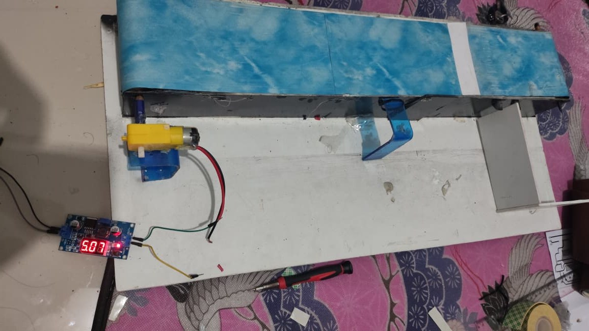
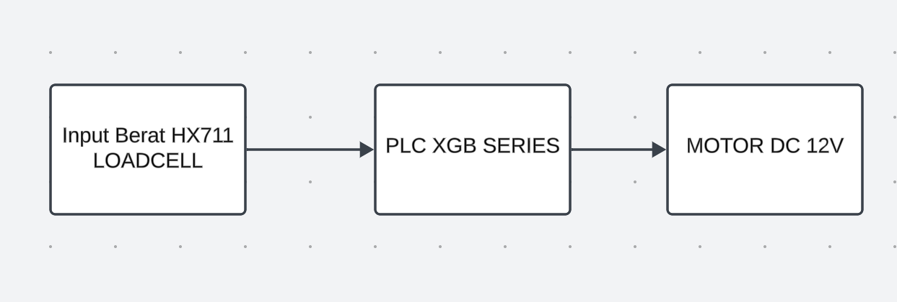
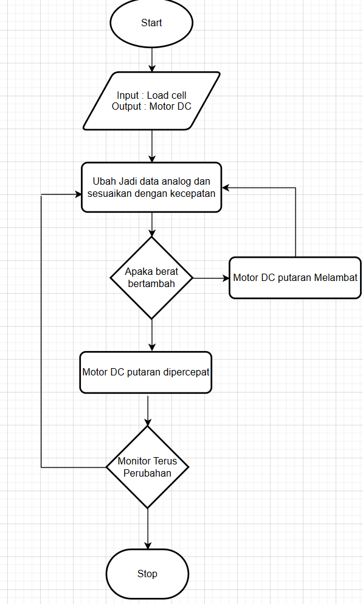
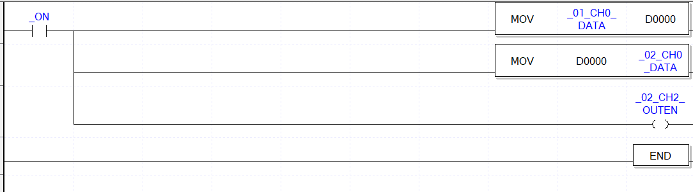

# Conveyor Speed Control by Load

A prototype conveyor that slows down as the load increases, so a downstream stone crusher is not overloaded. Built for a PLC course in January 2025.

## System

| | |
|---|---|
| **Sensor** | 5 kg load cell with HX711 |
| **Signal board** | Arduino |
| **Controller** | PLC XGB series |
| **Actuator** | 12 V DC gear motor |

## How it works

The Arduino reads the load cell and turns the weight into a PWM output on pin 9. A heavier load gives a lower output, and the PLC uses the signal to set the motor voltage.

| Weight | PWM | Output |
|---|---|---|
| 0 g | 255 | 5 V |
| 5000 g | 0 | 0 V |

## PLC ladder

The XG5000 program copies the analog input channel to D0000, writes it to the analog output channel, and enables that output.

## Repository contents

| Path | Contents |
|---|---|
| `arduino/load_to_analog_out/` | Maps weight to the PWM output |
| `arduino/loadcell_lcd/` | Load cell test with an I2C LCD |
| `images/` | Prototype photo, block diagram, flowchart and ladder screenshot |

Both sketches need the HX711 library. The load cell test also needs LiquidCrystal_I2C.

The XG5000 project file is not in this repository, so the ladder is shown as a screenshot.
